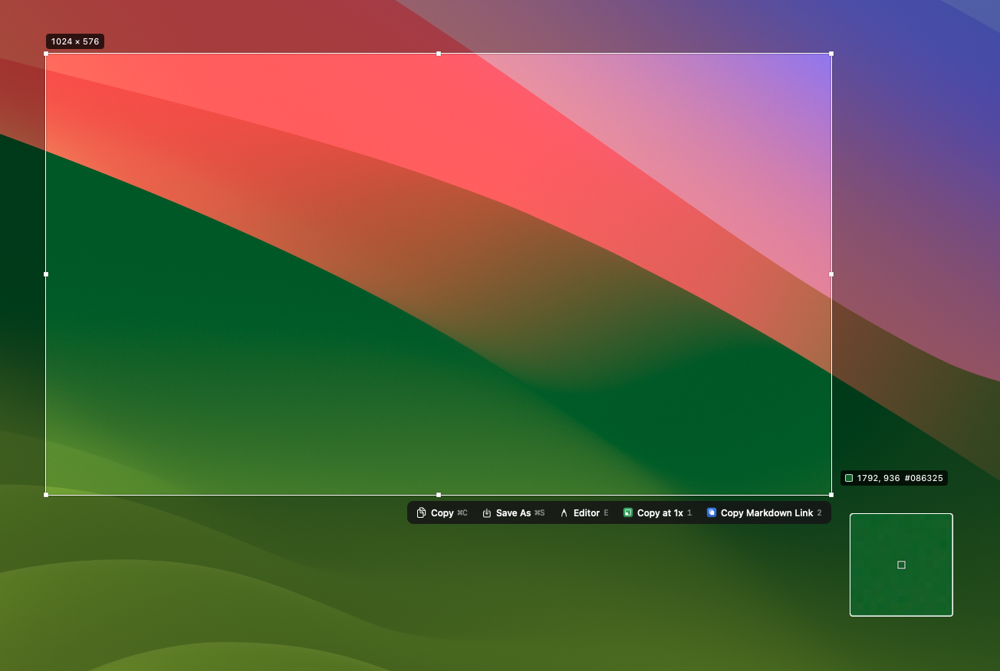
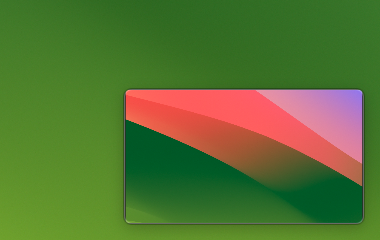
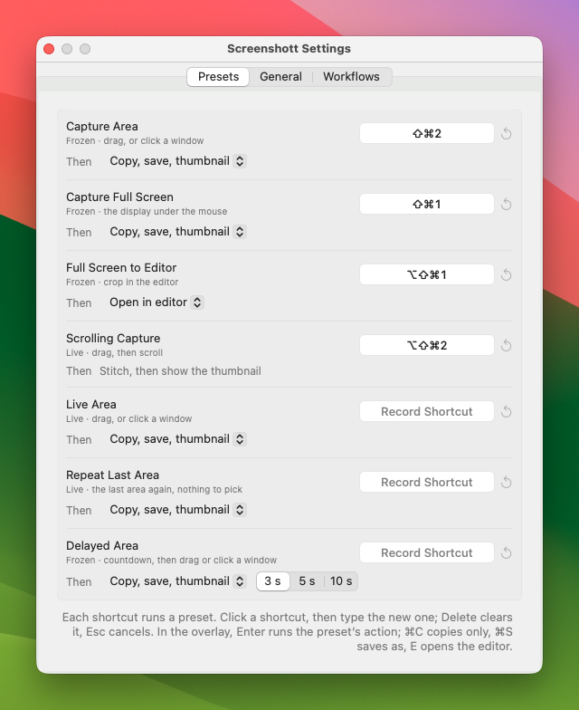
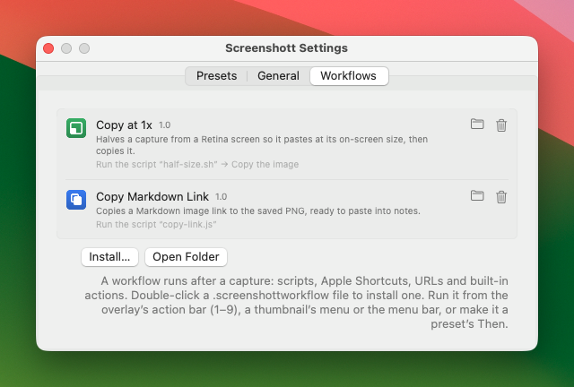
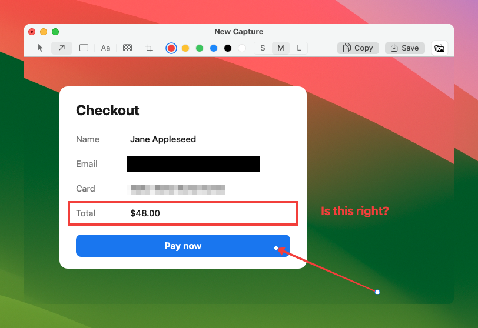
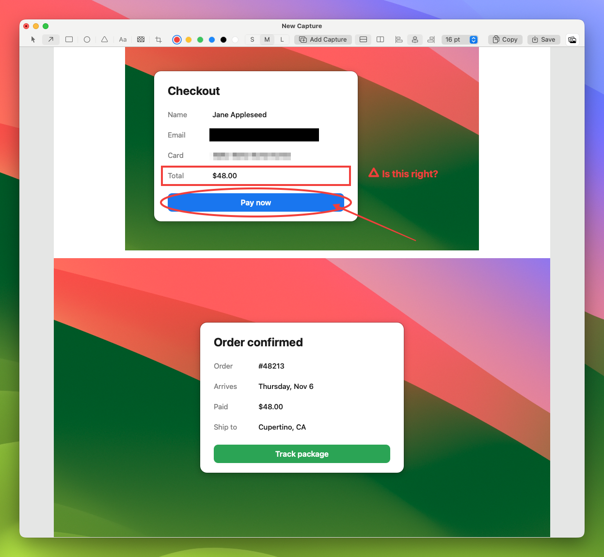
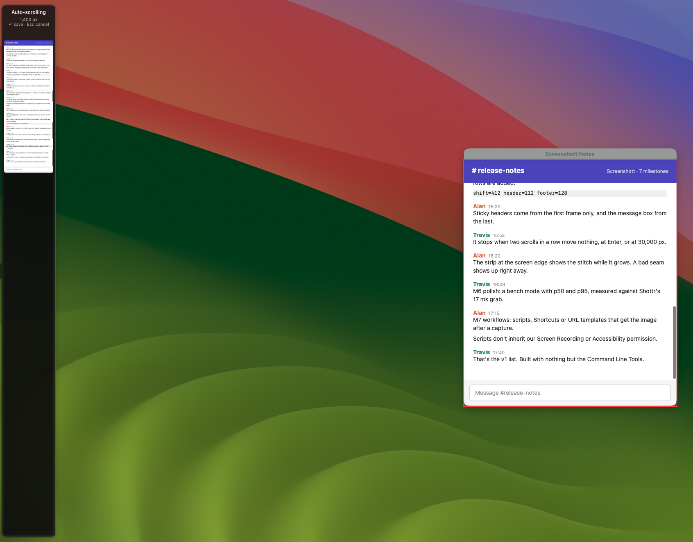
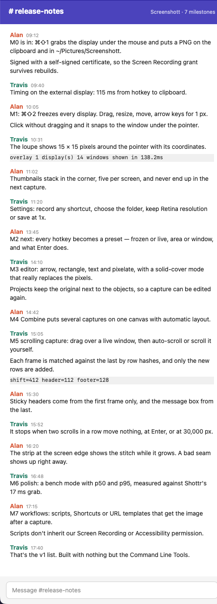

<p align="center">
  
</p>

<h1 align="center">Screenshott</h1>

<p align="center">
  A small, fast, keyboard-first screenshot app for macOS.<br>
  Native Swift, built with nothing but the Command Line Tools.
</p>

---

Screenshott is a menu bar app in the spirit of [Shottr](https://shottr.cc): press a
hotkey, get a pixel-exact PNG on the clipboard and in an archive folder, then
optionally mark it up. It is being built milestone by milestone; each milestone is a
vertical slice you can use day to day.

> **Status: v0.1.0, an early preview.** M0 is done; M1–M5 and M7 are built and in
> testing. Full-screen, area, live-area, delayed, repeat-last-area and scrolling
> capture, the editor, Combine and workflows are all in — see [Roadmap](#roadmap).

## Download

Get `Screenshott-<version>.dmg` from [Releases](../../releases), open it and drag
Screenshott to Applications. It runs on macOS 14 or later.

This preview is signed with a self-signed certificate, not an Apple Developer ID, so
macOS blocks the first launch. To open it the first time:

1. Open Screenshott from Applications. macOS says it can't verify the app; click **Done**.
2. Open **System Settings → Privacy & Security**, scroll down, and click **Open Anyway**
   next to the Screenshott message. Confirm with your password or Touch ID.
3. When asked, allow **Screen Recording** (and **Accessibility** if you want
   scrolling capture to scroll for you), then choose **Quit & Reopen**.

Later versions signed with the same certificate keep these permissions.

## Screenshots

<p align="center">
  
</p>

**⌘⇧2 area capture.** The screen freezes the instant you press the hotkey, so nothing
moves while you aim. Drag a selection, then adjust it: drag the
handles to resize, drag inside to move, or use the arrow keys for 1 px steps. The
label shows the exact size in pixels and the loupe magnifies the pixels under the
pointer. Click without dragging to snap to the window under the pointer. The bar under
the selection copies, saves elsewhere, opens the editor or runs a workflow, each with
its own key.

<p align="center">
  
</p>

**Floating thumbnail.** Every capture lands on the clipboard and in the archive
folder, and a thumbnail appears in the corner. Drag it into any app to drop the PNG
file, click it to mark it up in the editor, use the **+** to combine it with your next
capture, or right-click for Copy, Show in Finder, workflows and Move to Trash. It
fades out on its own after a few seconds.

<p align="center">
  
</p>

**Settings (⌘, from the menu bar menu).** Every hotkey runs a *preset*. For each one,
click the shortcut well and type a new combo (Delete clears it, Esc cancels, the arrow
resets it), and pick what happens after the capture. The General tab chooses where
captures are saved, whether 2x screens keep their full resolution, and whether each
capture is copied, shows a thumbnail and plays the shutter sound.

<p align="center">
  
</p>

**Workflows.** A workflow is a chain of steps that runs after a capture: your own
scripts, Apple Shortcuts, URL templates and built-in actions. Double-click a
`.screenshottworkflow` file to install one; run it from the overlay's bar, a
thumbnail or the menu bar, or make it what a preset does. See
[Writing a workflow](docs/workflows.md).

<p align="center">
  
</p>

**Editor.** Press **E** in the overlay or click a thumbnail. Draw arrows (**A**),
rectangles (**R**) and text (**T**); pixelate (**M**) as a mosaic or, pressing M again,
a solid cover — mosaicked text can sometimes be recovered, a solid cover can't. Crop
(**C**), pick a color and a size, drag anything to move it, drag a knob to reshape it.
⌘Z / ⇧⌘Z undo and redo, ⌘C copies, ⌘S saves, and the well at the right drags the
PNG into another app. The saved PNG is flattened — the pixels under a pixelate are
really gone — while the original and every object stay in a project file on your Mac,
so opening that PNG again lets you keep editing.

<p align="center">
  
</p>

**Combine.** Press **Add Capture** in the editor (⇧⌘A) or the **+** on a thumbnail:
the editor steps aside, you pick an area as usual, and it lands on the same canvas.
Stack captures in a column or a row, align them to either side or the middle, and
pick the gap. Annotations stay with the capture they were drawn on, and cropping one
capture closes up the others. With the select tool (**V**), click a capture and press
Delete to take it off again.

<p align="center">
  
</p>

**⌥⌘⇧2 scrolling capture.** The screen stays live. Drag over the part that scrolls,
or click it to take the scroll area under the pointer, then press **Enter** and
Screenshott scrolls it for you, or **M** to scroll it yourself. Each new frame is
matched against the last and only the new rows are added. A sticky header comes from
the first frame and a message box or footer from the last, so each appears once,
as in the result below. A strip at the edge of the screen shows the stitch as it grows,
so a bad seam shows while you can still press **Esc**. Auto-scroll stops by itself at
the bottom; **Enter** saves at any time, and a capture never goes past 30,000 pixels.
Select only the part that scrolls: a sidebar that stays put inside the selection keeps
the frames from lining up. Auto-scroll needs Accessibility permission; scrolling
yourself doesn't.

<p align="center">
  
</p>

The shots are generated by the app itself over a stock wallpaper —
see [README screenshots](#readme-screenshots).

## What works today

| | |
|---|---|
| **Menu bar app** | Lives in the menu bar, no Dock icon. The menu bar glyph is a template image, so it follows light and dark menu bars. |
| **⌘⇧1 full screen** | Captures the display under the mouse. Global hotkeys need no Accessibility permission. |
| **⌘⇧2 area** | Frozen overlay on every display; drag, resize, move, click to snap to a window, 1 px arrow-key nudges (⇧ for 10 px, ⌥ to resize). The selection stays until you press Enter or double-click it. |
| **Presets** | Seven of them (see [Presets](#presets)): area, full screen, full screen → editor, scrolling, live area, repeat last area and delayed area. Each has its own shortcut and its own action after the capture. All of them are also in the menu bar menu. |
| **Live area** | Drag over the moving screen and let go; the app you capture keeps its active look. A click takes the window under the pointer. |
| **Repeat last area** | Takes the same rectangle as the last area capture again, without picking. |
| **Delayed area** | A 3, 5 or 10 second countdown, then the frozen overlay. Click the countdown to cancel. |
| **⌥⌘⇧2 scrolling capture** | Drag over the part that scrolls, or click to take the scroll area or window under the pointer. **Enter** scrolls it for you (needs Accessibility); **M** lets you scroll it yourself. Frames are stitched as they arrive, sticky headers and footers appear once, a strip at the screen edge shows the result growing, and it stops at 30,000 px. **Enter** again saves, **Esc** cancels. |
| **Overlay keys** | **Enter** runs the preset's action · **⌘C** copy only · **⌘S** save as · **E** save and open in the editor · **1–9** run a workflow · **Esc** cancel. The same actions are on a bar under the selection. |
| **Workflows** | Post-capture chains of scripts (any language), Apple Shortcuts, URL templates and built-in actions. Scripts get the image path and details on stdin and in `SCREENSHOTT_*` variables and answer with JSON: copy text, show a message, open a URL, or hand back a new image. They run out of process, without Screenshott's Screen Recording permission. Three examples ship in `Examples/Workflows`. |
| **Custom shortcuts** | Record any combo in Settings. It must use two modifiers (or be a function key), can't clash with another preset or with macOS screenshots, Spotlight and app switching, and is checked against other apps that already hold it. |
| **Settings** | Presets: shortcut and what happens next (copy + save + thumbnail, copy only, save as, editor, or a workflow). General: save folder · keep full Retina resolution or save at 1x · copy to clipboard · show thumbnail · play sound · launch at login. Workflows: what's installed, install, remove. |
| **Floating thumbnail** | Drag out as a file, click to edit, **+** to combine with the next capture, right-click menu (copy, show in Finder, editor, workflows). Thumbnails stack per screen and never appear in your next capture. |
| **Editor** | Arrow, rectangle, text and pixelate (mosaic or solid) as movable, restylable objects; crop that can grow back out; zoom (⌘= / ⌘- / ⌘0 / ⌘9, pinch) and pan (scroll, or hold Space and drag); undo; copy, save, drag out. Single-letter tools: **V A R T M C**, sizes **1 2 3**. |
| **Combine** | Add Capture appends the next capture to the canvas; column or row, start / center / end alignment, no gap to 32 pt. A capture from a display with another scale is resampled to match. |
| **Re-editable** | The PNG in the save folder is always flat. The originals and objects go to `~/Library/Application Support/Screenshott/Projects/<PNG name>/`; opening that PNG again — from a thumbnail, *Open in Editor…* or Finder's *Open With* — continues where you left off. |
| **Clipboard + archive** | Every capture goes to the clipboard *and* to the save folder (`~/Pictures/Screenshott/` by default), so the next copy never loses a shot. Files are named `Screenshott 2026-11-02 at 09.41.27.png`. |
| **Retina-correct PNGs** | Cropped at physical pixels and saved with 144 DPI metadata on a 2x display, so a capture opens at its real size instead of double. |
| **Fast** | ⌘⇧2 puts the frozen overlay on screen in 74 ms (p50; p95 84 ms), down from 119 ms; ⌘⇧1 has the PNG on the clipboard and on disk in 110 ms, down from 133 ms. Measured with `scripts/bench.sh` on a 2560×1440 display (M3 Max, macOS 26.7). For comparison, Shottr publishes a 17 ms grab — ours is 35 ms — and ~165 ms to display. Each stage is timed in the log. |
| **Permission that sticks** | Signed with a stable self-signed certificate, so the Screen Recording grant survives rebuilds. If the grant is missing, the app offers *Open System Settings* and *Quit & Reopen*. |

## Roadmap

| Milestone | What it adds | Status |
|---|---|---|
| **M0 Skeleton** | Menu bar app, ⌘⇧1 full screen → clipboard + archive, signing, permission flow | ✅ Done |
| **M1 Frozen overlay** | ⌘⇧2 area capture on a frozen screen: drag to select, click to snap to a window, magnifier, 1 px arrow-key nudge, multi-display, floating thumbnail with drag-out | 🧪 Built; tested on one 1x display, Retina and multi-display next |
| **M2 Presets & hotkeys** | Every hotkey is a preset: frozen or live × no selection / area / window × what Enter does. Hotkey recorder, settings, shared action interface | 🧪 Built; hands-on test of Live Area next |
| **M3 Editor** | Crop, zoom, arrow, rectangle, text, pixelate (with a solid-cover mode that really replaces the pixels). Re-editable after saving | 🧪 Built; hands-on test next |
| **M4 Combine** | Put several captures on one canvas with automatic layout | 🧪 Built; hands-on test next |
| **M5 Scrolling capture** | Auto-scroll or manual scroll, overlap stitching, sticky header/footer removal, live stitch preview, 30,000 px cap | 🧪 Built; hands-on test against the app list next |
| **M7 Workflows** | Alfred-style post-capture workflows: scripts, Apple Shortcuts or URL templates that receive the image and decide where it goes next | 🧪 Built; three examples |
| **M6 Polish** | Benchmark mode (p50/p95 against Shottr's 17 ms grab), launch at login | 🚧 Bench mode and faster capture done; PNG encoding off the main thread next |

### Presets

| Preset | Screen | How you pick | Then, by default | Hotkey |
|---|---|---|---|---|
| Capture Area | Frozen | Drag; click snaps to a window | Copy + save + thumbnail | ⌘⇧2 |
| Capture Full Screen | Frozen | Display under the mouse | Copy + save + thumbnail | ⌘⇧1 |
| Full Screen to Editor | Frozen | Crop in the editor | Open the editor | ⌥⌘⇧1 |
| Scrolling Capture | Live | Drag, then scroll | Stitch → copy + save + thumbnail | ⌥⌘⇧2 |
| Live Area | Live | Drag; letting go captures | Copy + save + thumbnail | Unbound |
| Repeat Last Area | Live | Nothing to pick | Copy + save + thumbnail | Unbound |
| Delayed Area | Frozen | Countdown, then drag | Copy + save + thumbnail | Unbound |

Inside the overlay: **Enter** runs the preset's action · **⌘C** copy only ·
**⌘S** save as · **E** open in the editor · **Esc** cancel.

These avoid the system's ⌘⇧3 / ⌘⇧4 / ⌘⇧5. Shottr uses ⌘⇧1 and ⌘⇧2 by default,
so quit it (or rebind it) while running Screenshott.

## Build

Requirements: macOS 14 or later and the Xcode **Command Line Tools** (Swift 6).
Xcode itself is not needed.

```bash
scripts/bundle.sh          # release build → dist/Screenshott.app
scripts/bundle.sh debug    # debug build
open dist/Screenshott.app
scripts/make-dmg.sh        # dist/Screenshott-<version>.dmg for a release
```

`make-dmg.sh` packs the built app with a link to Applications, the example workflows
and a *Read Me First* note with the first-launch steps, then signs the image with the
app's identity.

`bundle.sh` quits a running Screenshott before replacing the bundle and reopens it
afterwards, so you never test the old build by accident.

**Signing.** macOS ties the Screen Recording permission of an ad-hoc signed app to
its exact code hash, which changes on every build, so the permission would silently
lapse after each rebuild. Create a self-signed code-signing certificate once
(Keychain Access → Certificate Assistant → Create a Certificate → Self Signed Root,
type *Code Signing*) and name it `Screenshott Dev`, or point
`SCREENSHOTT_SIGN_IDENTITY` at an existing one. The script falls back to ad-hoc
signing with a warning.

**Tests.** `scripts/test.sh` runs the Swift Testing suite. It passes the
`TestingMacros` plugin path explicitly, which some Command Line Tools installs need.

**Self-test.** `scripts/self-test.sh` drives Delayed Area, Repeat Last Area and the
example workflows in the built app without a mouse and prints PASS or FAIL for each.

**Workflows.** `scripts/pack-workflows.sh` zips each example in `Examples/Workflows`
into `dist/workflows/*.screenshottworkflow`; double-click one to install it.
`scripts/verify-disclaim.sh` checks on a real build that a workflow step can't use
Screenshott's Screen Recording permission: it starts a probe both ways and expects
`inherited=true disclaimed=false`.

**Icon.** `scripts/make-icon.sh` redraws `Support/AppIcon.icns` from the vector
code in `Tools/MakeIcon`, rendering each size separately so small sizes stay crisp.

### Benchmark

```bash
scripts/bench.sh           # 20 rounds, about 2 minutes → dist/bench/<date>.txt
```

Launches the built app with `--bench 20`, which times every capture stage with no input
and logs p50/p95: the old and new grab paths side by side, ⌘⇧1 end to end, and ⌘⇧2 up to
the overlay being on screen. Bench captures go to a temp folder that is deleted
afterwards and to a private pasteboard, so nothing reaches the save folder or the
clipboard. Keep off the keyboard, mouse and menu bar icon while it runs: the overlay
flashes up about 60 times. `--sample` also records a `sample` profile of the run.

### README screenshots

```bash
scripts/readme-shots.sh    # → dist/readme-shots/overlay.png, thumbnail.png, settings.png, workflows.png, editor.png, combine.png,
                           #   scrolling.png, scrolling-result.png
scripts/readme-shots.sh dist/readme-shots scrolling   # just the scrolling capture
```

Launches the built app with `--readme-shots`. It covers the display under the mouse
with a stock macOS wallpaper, opens the real overlay with a staged selection, presses
Enter, opens Settings on its Presets and Workflows tabs, then captures a made-up
checkout card and marks it up in the editor, auto-scrolls a made-up chat page through
the real scrolling capture, and photographs each step, already
cropped. Nothing that was on your screen ends up in the images, and only the example
workflows are shown, whatever else is installed. It has the side effects of real captures: the shutter
sound, the clipboard, and an area capture and the scrolling capture saved in
`~/Pictures/Screenshott/`.

## Project layout

```
Sources/Screenshott/       AppKit app: menu bar, presets, capture, overlay, thumbnails, workflows
Sources/ScreenshottCore/   Pure logic with no UI, covered by unit tests: presets, actions, workflow.json
Tests/                     Swift Testing suite for ScreenshottCore
Examples/Workflows/        The three example workflows
Tools/MakeIcon/            App icon drawing code
Tools/TCCProbe/            Permission probe for verify-disclaim.sh
Support/                   Info.plist and AppIcon.icns
docs/workflows.md          How to write a workflow
scripts/                   bundle.sh, make-dmg.sh, test.sh, self-test.sh, make-icon.sh, readme-shots.sh, bench.sh, pack-workflows.sh, verify-disclaim.sh
requirements.md            Decision log: every product and technical choice, with reasons (Chinese)
```

The log is at `~/Library/Logs/Screenshott.log`. Each launch records the version,
code hash and permission state; each capture records how long listing displays,
grabbing pixels, encoding and saving took. The same stages are `os_signpost` intervals:
`log stream --signpost --predicate 'subsystem == "com.adong.Screenshott"'` shows them live.
